# Relay60 implementation report

This document is a review packet. It records what the implementing agent built for the Relay60 monorepo, where the result follows the supplied blueprint, where it does not, and what was verified. Screenshots are in `screenshots/` next to this file. They were taken on 16 November 2026 from the running app at `http://127.0.0.1:3000`, with the API at `http://127.0.0.1:8000`.

A reviewing agent should judge the implementation against the original blueprint and against the later user instruction to empty the legal pages. The screenshots are evidence of the UI that existed at capture time. They are not a substitute for reading the source.

## 1. What was asked

The user pasted a locked blueprint for a production monorepo named Relay60 (`relay60.com`). The user said they were not necessarily agreeing with the prompt; they were passing on what another model had specified.

The blueprint required:

- Exactly the enumerated source files. The count given was 87: 4 root files, 49 backend files, 34 frontend files.
- `snake_case` JSON across the API. No camelCase conversion of request or response keys.
- UI, legal, simulator, and error strings copied verbatim from the blueprint.
- Pinned dependencies. Next.js 14.2.21, React 18.3.1, Tailwind CSS 3.4.17. No Next 15, React 19, Tailwind 4, shadcn, Radix, Headless UI, Framer Motion, axios, zod, or react-hook-form.
- Named Tailwind token strings in `frontend/src/lib/tokens.ts`, and only the 26 listed `lucide-react` icons.
- Phases 1 through 7 in order, with the listed shell checks after each phase.
- The app must boot, simulate, calculate ROI, store leads in SQLite, log dispatches through `LocalLogAdapter`, and pass pytest, ruff, `tsc --noEmit`, and `npm run build` with the example environment and no paid API keys.

The product is a marketing site plus API for a done-for-you 60-second lead-response service aimed at US and UK appointment businesses. It is not a live SMS or CRM integration. Empty webhook URLs are supposed to log locally.

After the build, the user asked to make the privacy policy and terms empty. That instruction overrides the earlier attempt to fill those pages. The current pages are empty. Section 6 records both the original fill and the later removal.

## 2. How the work was done

The workspace started with a generic `.gitignore` and a one-line `README.md`. Implementation followed the blueprint's phase order:

1. Root config, Docker, Makefiles, pinned manifests, and example env files. Backend virtualenv and `npm install` were run before application code.
2. Settings, async SQLAlchemy, errors, middleware, rate limiter, security, models, and Alembic. `alembic upgrade head`, `downgrade base`, `upgrade head`, and `ruff check app alembic` were run.
3. Pydantic schemas, adapters, simulator engine, ROI calculator, lead pipeline, and FastAPI routes.
4. The 14 pytest tests. They failed once because `httpx` 0.28.1 `ASGITransport` does not accept a `lifespan` argument. That argument was removed. All 14 tests then passed.
5. Frontend tokens, types, region context, API client, layout, and legal routes.
6. Marketing sections, simulator, ROI calculator, booking form, and home page. `tsc`, `next lint`, and `next build` passed.
7. `docker compose config` passed. A live Uvicorn process answered health, simulation, lead creation, and admin list curls. Pytest and ruff were run again.

The frontend production server was later stopped so `next dev` could serve the emptied legal pages on port 3000. The screenshots in this packet are from that dev server, after the legal pages were emptied.

## 3. What exists in the repository

### Application layout

- `backend/`: FastAPI app, SQLAlchemy models, Alembic revision `0001_initial`, adapters, services, and tests.
- `frontend/`: Next.js 14 App Router site.
- `docker-compose.yml`: backend and frontend services, SQLite named volume, backend health check. The compose file was validated. The images were not built or run.
- `Makefile`: `install-backend`, `install-frontend`, `dev-backend`, `dev-frontend`, `test-backend`, `check-frontend`, `migrate`.
- `backend/.env` and `frontend/.env.local` were copied from the example files so local boot did not need secrets. Those copies are gitignored.

### Files that are not part of the original 87

These were created by tools or by later requests:

- `frontend/package-lock.json` from `npm install`.
- `frontend/next-env.d.ts` and `frontend/tsconfig.tsbuildinfo` from Next and `tsc`.
- `backend/relay60.db` from Alembic and the live API. Gitignored.
- `docs/implementation-report/` this review packet, added because the user asked for documentation.

### Dependency pins that were actually installed

Backend, from `backend/requirements.txt`: FastAPI 0.115.6, Uvicorn 0.34.0, Pydantic 2.10.4, pydantic-settings 2.7.1, email-validator 2.2.0, SQLAlchemy 2.0.36, aiosqlite 0.20.0, asyncpg 0.30.0, Alembic 1.14.0, httpx 0.28.1, pytest 8.3.4, pytest-asyncio 0.25.2, ruff 0.9.1.

Frontend, from `frontend/package.json`: Next 14.2.21, React and React DOM 18.3.1, lucide-react 0.468.0, Tailwind 3.4.17, TypeScript 5.7.2. `npm install` warned that Next 14.2.21 has a published security advisory. It was not upgraded, because the blueprint forbids version substitution.

## 4. Backend behavior

### Process and configuration

`backend/app/main.py` builds the app with a lifespan. When `AUTO_CREATE_SCHEMA` is true, startup runs `Base.metadata.create_all`. Shutdown disposes the engine. CORS allows GET, POST, PATCH, and OPTIONS from the configured origins, and exposes `X-Request-ID` and `Retry-After`. `RequestIdMiddleware` keeps a valid incoming `X-Request-ID` or generates a UUID.

Errors use one envelope: `{ "error": { "code", "message", "field_errors" } }`. `AppError` supplies 400, 401, 404, 429, and database-health failures. Request validation becomes HTTP 422 `VALIDATION_ERROR`, and the handler strips Pydantic's `"Value error, "` prefix. Unhandled exceptions become HTTP 500 `INTERNAL_SERVER_ERROR` with the blueprint message.

`Settings` loads `.env` through pydantic-settings. `postgres://` and `postgresql://` are rewritten to `postgresql+asyncpg://`. CORS origins are split on commas. The admin key and IP salt have minimum lengths. Defaults match `backend/.env.example`, including `ADMIN_API_KEY=dev-relay60-admin-key-change-me-2026`.

### Data model

Primary keys are string UUIDs. Timestamps are timezone-aware UTC. Enums are `(str, Enum)` and are stored with SQLAlchemy `Enum(..., native_enum=False)` so SQLite and PostgreSQL both use variable-length strings.

Tables:

- `leads`: contact, business, vertical, region, volume, consent, UTM, status, admin notes.
- `lead_dispatch_logs`: four channel rows per lead, cascading on lead delete.
- `demo_simulations`: one row per simulator run, with a hashed IP and the first message truncated to 300 characters.

Admin status changes use `ALLOWED_ADMIN_TRANSITIONS` in `backend/app/models/enums.py`. The same status is allowed when only notes change. Any other transition raises `INVALID_STATUS_TRANSITION`.

The Alembic revision `0001_initial` creates the three tables and the indexes named in the models. It uses plain `String` columns rather than SQLAlchemy enum objects. That matches portable varchar storage. `render_as_batch=True` is set so SQLite downgrades work. Downgrade drops dispatch logs, simulations, then leads.

### Routes

All routes are under `/api/v1`.

| Method | Path | Auth | Limit |
| --- | --- | --- | --- |
| GET | `/health` | public | none |
| POST | `/simulations/run` | public | 15/min/IP |
| POST | `/simulations/roi` | public | 30/min/IP, hardcoded |
| POST | `/leads` | public | 5/min/IP |
| GET | `/admin/leads` | `X-Admin-API-Key` | none |
| GET | `/admin/leads/{id}` | same | none |
| PATCH | `/admin/leads/{id}` | same | none |

There is no admin web UI. The blueprint only specified the API.

The rate limiter is an in-memory sliding window keyed by bucket name and client IP. It reads the first `X-Forwarded-For` address, otherwise the socket address, otherwise `127.0.0.1`. Tests reset it with an autouse fixture.

FastAPI parses and validates the body before the route function runs. A 422 therefore does not consume a rate-limit slot. The blueprint's prose says "rate limit, then validate." The tests do not require invalid bodies to count. Valid lead requests do count, and the sixth valid lead from one IP returns 429 with `Retry-After`.

### Leads and dispatch

`POST /leads` normalizes the phone, stores the lead as `received`, hashes the IP with SHA-256 and `IP_HASH_SALT`, and schedules `execute_lead_dispatch_pipeline` on a new session from `get_session_maker()`. The request session is not reused inside the background task.

Phone rules, implemented because the blueprint required them:

- Spaces, hyphens, parentheses, and dots are removed.
- UK domestic `0` plus 9 or 10 further digits becomes `+44` plus the rest when region is UK. Example: `07700 900412` becomes `+447700900412`.
- A US 10-digit number starting with 2-9 becomes `+1` plus those digits when region is US. Example: `(512) 555-0194` becomes `+15125550194`.
- Otherwise the value must match `+` optional, first digit 1-9, then 9 to 14 more digits.
- `region` is declared before `phone` on the Pydantic model so the validator can read the region. JSON key names are unchanged.

`privacy_consent` must be exactly `true`. `sms_consent` may be false.

The pipeline sets status to `responding`, then runs email, SMS, CRM, and founder alert in that order.

- Email, CRM, and founder alert call the adapter registry.
- If `sms_consent` is false, no SMS adapter is called. A log row is written with `adapter_used="compliance_gate"`, `status="skipped"`, and payload `{"reason": "sms_consent_false"}`.
- If SMS consent is true, the SMS body includes `Reply STOP to opt out`.
- Zero failures and at least one send becomes `responded`. Mixed send and failure becomes `partial_failure`. No sends and at least one failure becomes `failed`. A skipped SMS is not a failure, so a normal local lead with SMS off ends as `responded`.

The registry uses `HttpWebhookAdapter` only when the URL starts with `http://` or `https://`. Otherwise it uses `LocalLogAdapter`, which logs and returns `sent`. Webhook failures are caught and stored as `failed`. They do not crash the background task. No test calls a real webhook.

The create response always uses:

- `confirmation_headline`: `Pipeline Triggered in Real Time — Your Enquiry Is Locked In.`
- `confirmation_message`: `We just recorded your enquiry, queued your instant email confirmation, synced our internal CRM, and alerted an onboarding engineer.`
- `sla_target_seconds`: 60
- `email_ack_queued`: true
- `sms_ack_queued`: true only when SMS consent is true

### Simulator and ROI

`build_simulation_response` returns five steps at 0, 8, 23, 39, and 51 seconds. The 12 preset scripts are the blueprint strings with regional tokens substituted. US dental SMS includes `$189` and an `A2P 10DLC` compliance footer. UK trades SMS includes `combi boiler`, `£75`, and `£740`, plus a `UK GDPR` footer.

The compliance footer sentences were written by the implementer. The blueprint required those phrases to appear and described TCPA and UK GDPR behavior, but it did not give one exact footer sentence. A reviewer should treat the footer wording as implementer-authored, not as a verbatim clause.

Custom enquiries must be 10 to 280 characters after stripping `<` and `>`. Shorter text returns 422 on `custom_enquiry`. Keyword order is price, then urgent, then evening/weekend, then the default sentence. The test string `Hi, how much is an urgent appointment tomorrow evening?` hits the price branch first. For US medspa, the 8-second reply contains `$50`.

For a custom enquiry, steps 39 and 51 start from the preset CRM and calendar sentences, and the first `]` in each sentence is replaced with `, Custom Live Test]`. If a sentence has no bracket, the tag is appended. That is an interpretation of "append Custom Live Test to the tags," not a second set of fully written custom scripts.

ROI uses the blueprint breakpoints and fees. US at 65 enquiries, $850 value, 22% close rate, and 120 minutes response is locked by a test:

- lost revenue `5834`
- recovered revenue `4376`
- payback `11` and `11 days`
- setup `995`, monthly `497`

The UK extreme case, 5 enquiries, value 100, 60% close rate, 5 minutes response, returns a positive recovered amount and `90+ days`. Python money rounding uses `floor(x + 0.5)`. The one-decimal booking count uses Python `round`. The TypeScript client uses `Math.round` for both. The tested positive values match.

## 5. Frontend behavior

The site is a Next.js App Router application. `layout.tsx` is a server component. It loads Plus Jakarta Sans, Inter, and JetBrains Mono with the specified weights and CSS variables, and wraps every page in `RegionProvider`, `Navbar`, and `Footer`.

`RegionContext` always renders `US` on the server and on the first client render. After mount it reads `relay60_region_v1`. If that value is `US` or `UK`, it uses it. Otherwise `Europe/London` selects UK. `setRegion` writes localStorage. This is the blueprint's hydration rule.

Prices, phone placeholders, compliance badges, and simulator requests use the active region. The ROI ticket slider starts at 850. If the user has not moved that slider, switching region sets it to 850 for US or 650 for UK. There is a short gap after hydration: region can already be UK while the slider is still 850, until the ROI effect runs. A reviewer who watches the first paint can see UK currency applied to the US default ticket for one update. The screenshots were taken after that effect, so they show the settled values.

The home page order is hero, problem strip, simulator, how it works, ROI, industries, pricing, FAQ, lead form.

The simulator loads the dental SMS preset on mount and again when region, vertical, or channel changes, unless the visitor is in custom mode. The initial load shows all five steps at once. The run button then asks the API again and reveals steps at 0, 650, 1400, 2150, and 2900 milliseconds. Timers and the fetch abort controller are cleared on unmount and before a new run.

The ROI calculator is client-side. It does not call `POST /simulations/roi`. The API calculator still exists and is covered by pytest. The visible US defaults in the screenshot match the API test: lost `$5,834`, recovered `$4,376`, net `$3,879`, payback `11 days`.

The lead form keeps SMS consent and privacy consent unchecked. Client validation uses the blueprint messages for name, email, phone length, business name, and privacy consent. It does not require SMS consent. UTM values are read from the query string on mount. A successful response replaces the form with the confirmation card. If `NEXT_PUBLIC_BOOKING_EMBED_URL` starts with `https://cal.com/` or `https://calendly.com/`, the confirmation also renders the 620px iframe. The example env leaves that value empty, so the screenshots show the native slot-preference card.

JSON-LD on the home page contains the Service graph and the eight FAQ questions.

## 6. Where the result does not match the blueprint

These are the points a reviewer should not have to discover by diffing.

1. **Legal pages were filled, then emptied.** The pasted blueprint referred to seven privacy clauses and six terms clauses in sections 7.12.2 and 7.12.3, but those clause bodies were not in the prompt. The implementer wrote clauses from the locked company names, addresses, emails, TCPA language, and UK GDPR facts, and rendered them on `/privacy` and `/terms`. The user then said to make the privacy policy and terms empty. The clause arrays in `frontend/src/lib/copy.ts` are now empty, and both page components return `null`. The routes still exist. The browser tab titles remain `Privacy Policy | Relay60` and `Terms of Service & SMS Terms | Relay60`. Header and footer still render because they come from the root layout. This is a deliberate later change, not the original blueprint.

2. **Token count.** The blueprint said "24 keys" and then listed 26 class strings, including `SELECT`, `CHECKBOX`, and `ERROR_TEXT`. All 26 listed strings were implemented.

3. **Compliance footer wording** is implementer-authored around the required `A2P 10DLC` and `UK GDPR` phrases. See section 4.

4. **Custom simulator steps 39 and 51** reuse the preset sentences and insert `Custom Live Test` into the tag list. See section 4.

5. **Validation versus rate limiting order** follows FastAPI's normal body parsing. Invalid bodies do not consume the limiter. See section 4.

6. **Alembic columns are plain strings**, while the ORM uses non-native enums. Both store the enum value as text. Tests use `create_all` from the ORM metadata, not only the migration.

7. **Docker was not executed.** `docker compose config` succeeded. No image build or container boot was run.

8. **No admin screenshots exist** because there is no admin page. Admin behavior is covered by pytest only.

9. **Generated and local files** listed in section 3 sit outside the original 87-file tree.

10. **The lead-form privacy sentence** is split so `Privacy Policy` and `Terms of Service` are links. The visible words match the blueprint sentence. An earlier render inserted a space before the comma because of a newline between JSX nodes. That newline was removed. The confirmation screenshot was taken after that fix. The validation screenshot still shows the linked sentence.

## 7. Verification that was actually run

### Automated checks

Re-run while writing this report:

- `backend/.venv/bin/pytest -q`: `14 passed in 0.37s`. Output is in `pytest-output.txt`.
- `backend/.venv/bin/ruff check .`: `All checks passed!` Output is in `ruff-output.txt`.

Earlier in the same build:

- Alembic upgrade, downgrade to base, and upgrade again succeeded on SQLite.
- `cd frontend && npm run typecheck && npm run lint && npm run build` succeeded. The production build listed `/`, `/privacy`, `/terms`, and `/_not-found`.
- `docker compose config` exited 0.
- Live curls against Uvicorn returned health `status=ok` and `database=connected`, a dental SMS simulation with 5 steps and `total_elapsed_seconds=51`, a lead create with `response_status=received`, `sms_ack_queued=false`, `email_ack_queued=true`, and an admin list with `total=1`.

The 14 tests are:

- health returns 200, `database=connected`, and `X-Request-ID`
- US ROI benchmark numbers listed in section 4
- UK ROI extreme case, no division by zero, `90+ days`
- US dental SMS preset, `$189`, `A2P 10DLC`, one simulation row
- UK trades SMS localization, `combi boiler`, `£75`, `£740`, `UK GDPR`
- custom enquiry shorter than 10 characters returns 422; the price example returns the custom text and `$50`
- lead without SMS consent returns 201, stores `+15125550194`, ends `responded`, skips SMS, sends the other three channels
- UK lead with SMS consent stores `+447700900412` and sends all four channels
- missing privacy consent returns 422 and writes no lead
- invalid email and phone return 422 with both field keys
- admin list without a key, and with the wrong key, returns 401
- admin list and detail include the lead, one simulation, four dispatch logs, and a 64-character IP hash that is not the raw IP
- patch to `booked` succeeds; patch back to `received` returns `INVALID_STATUS_TRANSITION`
- the sixth lead in a minute returns 429 and `Retry-After` of at least 1

### Browser checks before this report

During the build, a browser session was used against the production server and then the dev server:

- UK region changed the hero footer, pricing, phone placeholder, simulator clinic, and ROI currency.
- An empty lead form showed the name, email, phone, business, and privacy messages, and focused the name field.
- A completed UK submission showed the confirmation card and the SMS-skipped line.

The screenshots below were taken later, after the legal pages were emptied, using headless Chrome at 1440×1000 and 390×844 against the dev server. Section crops hide the sticky header so the section itself is readable. The full-page images keep the real header and footer. The validation and confirmation crops were taken in the first pass and still include the sticky header over the top of the section.

## 8. Screenshots

### Home page, United States, desktop

Full page, 1440px wide. This is the settled US page after region hydration, with the simulator already loaded.

Hero only. The right card is the static operational snapshot, not the live simulator. The footer line is the US price: `$995` setup and `$497/mo`.

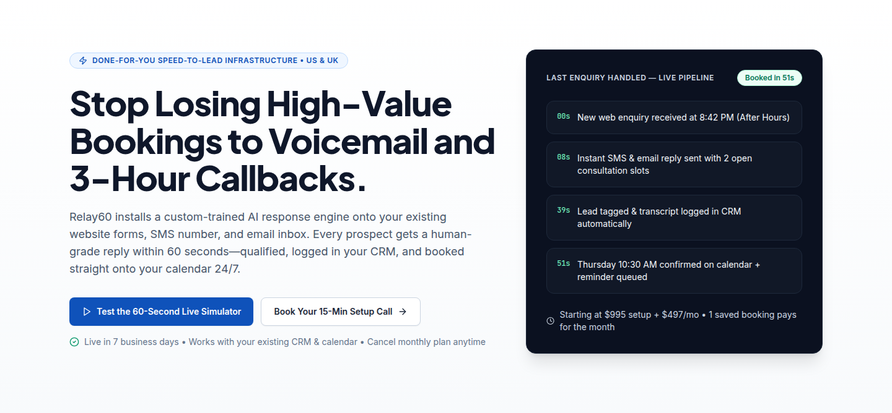

### Simulator

US dental SMS preset after the automatic load. All five steps are visible. The 8-second reply names Oakridge Dental Studio and `$189`. The CRM card shows Sarah Jenkins, `+1 (512) 555-0148`, and `$1,450`. The footer contains the US TCPA and `A2P 10DLC` text.

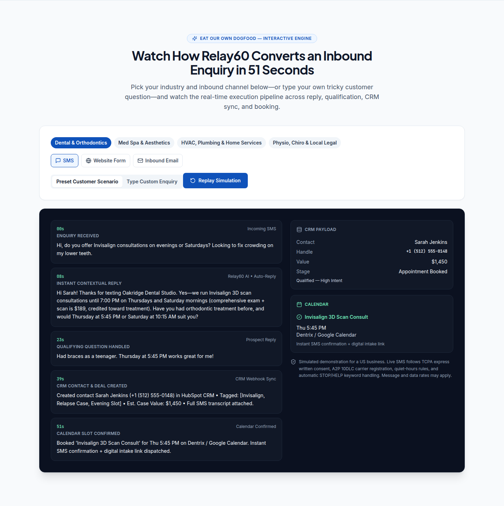

The same preset after switching the page to UK. The reply names Kensington Smile Clinic and `£145`. The CRM value is `£1,150`. The calendar target is `Dentally / Google Calendar`. The footer is the UK GDPR and PECR text.

US HVAC preset. This checks that the vertical control changes the script, not only the styling.

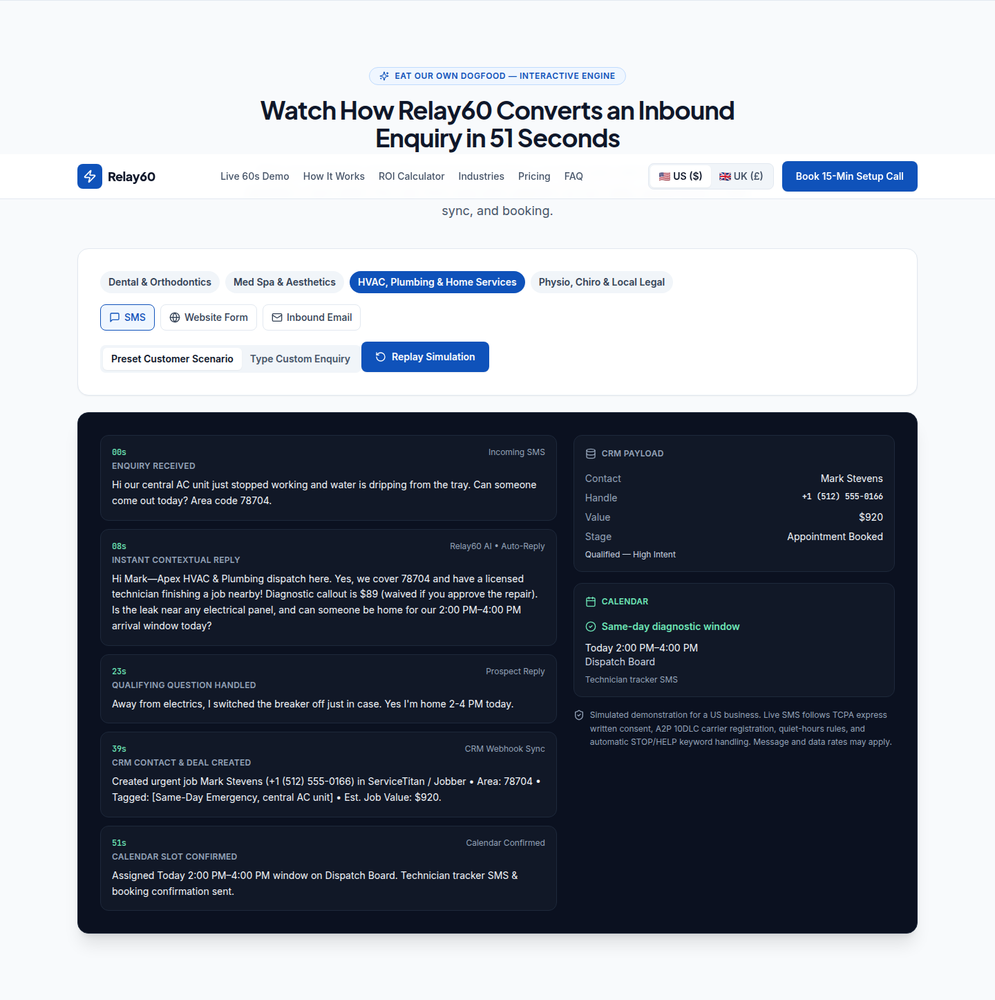

What these images do not show: the staggered replay animation, the custom-enquiry box, a too-short custom enquiry error, or the loading state. Those paths exist in `SimulatorSection.tsx` and, for the API, in `test_simulations.py`.

### How it works, industries, and FAQ

Three steps and the ten integration pills.

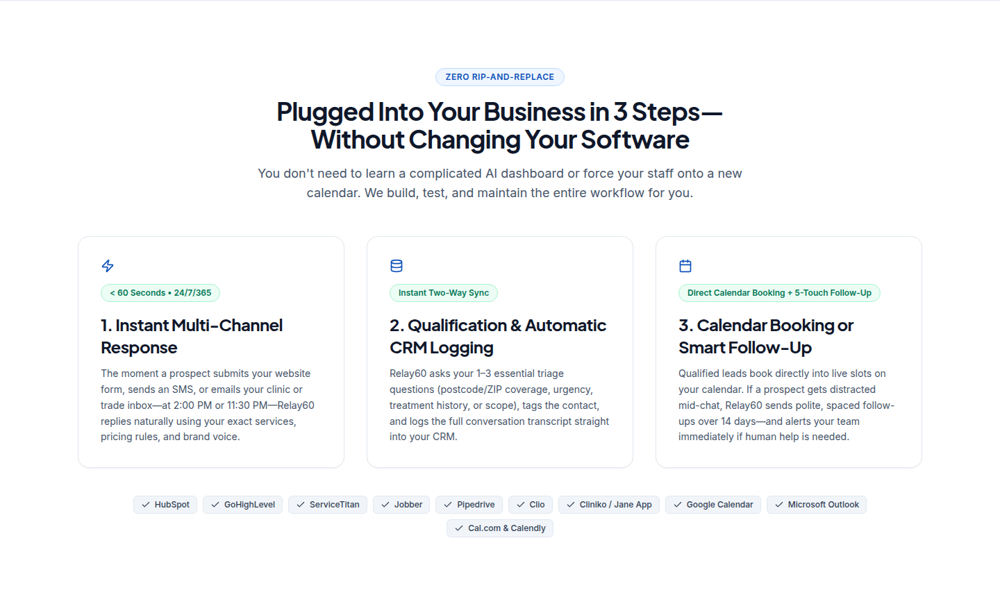

Dental tab, the default.

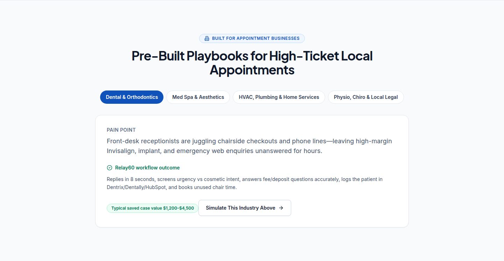

HVAC tab after clicking the tab. The pain point and outcome change. The saved-value badge in this US capture is the trades range.

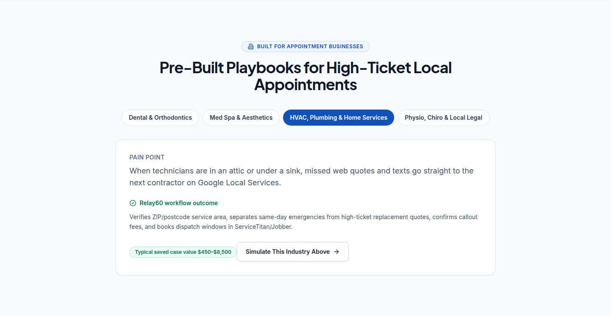

FAQ with the first item open and the other seven collapsed. The questions are the eight blueprint questions.

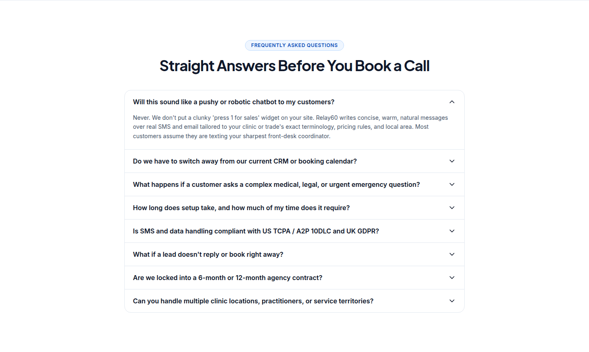

### ROI calculator

US defaults. The numbers on the right match the pytest benchmark: lost `$5,834`, recovered `$4,376`, net `$3,879`, payback `11 days`. The response slider sits on `2 hours`, which is 120 minutes.

UK after the region switch and after the default ticket moves to `£650`. Currency labels and the fee line use pounds. This screenshot is the settled state, not the one-frame hydration gap described in section 5.

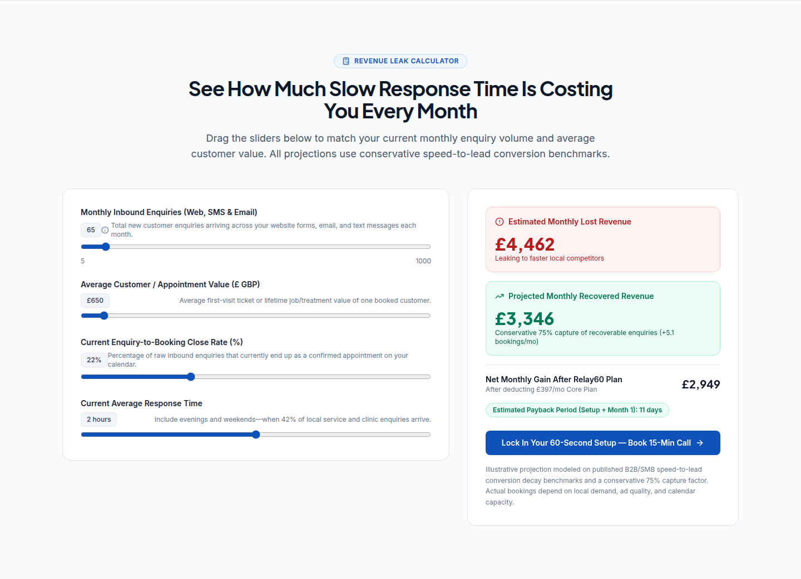

### Pricing

US: `$497/month` and `$995` setup on Core, `$897/month` and `$1,795` setup on Pro.

UK: `£397/month` and `£795` setup on Core, `£697/month` and `£1,450` setup on Pro. The guarantee banner is the blueprint's double-lock text.

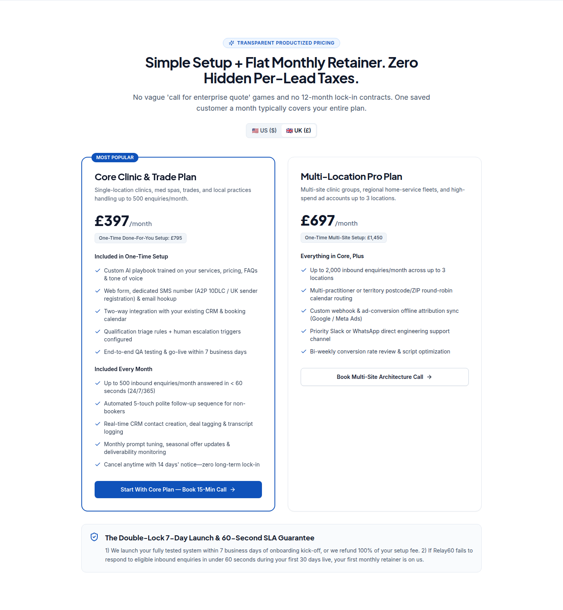

### Lead form

Empty US form before submit. SMS and privacy are unchecked. The phone placeholder is the US example.

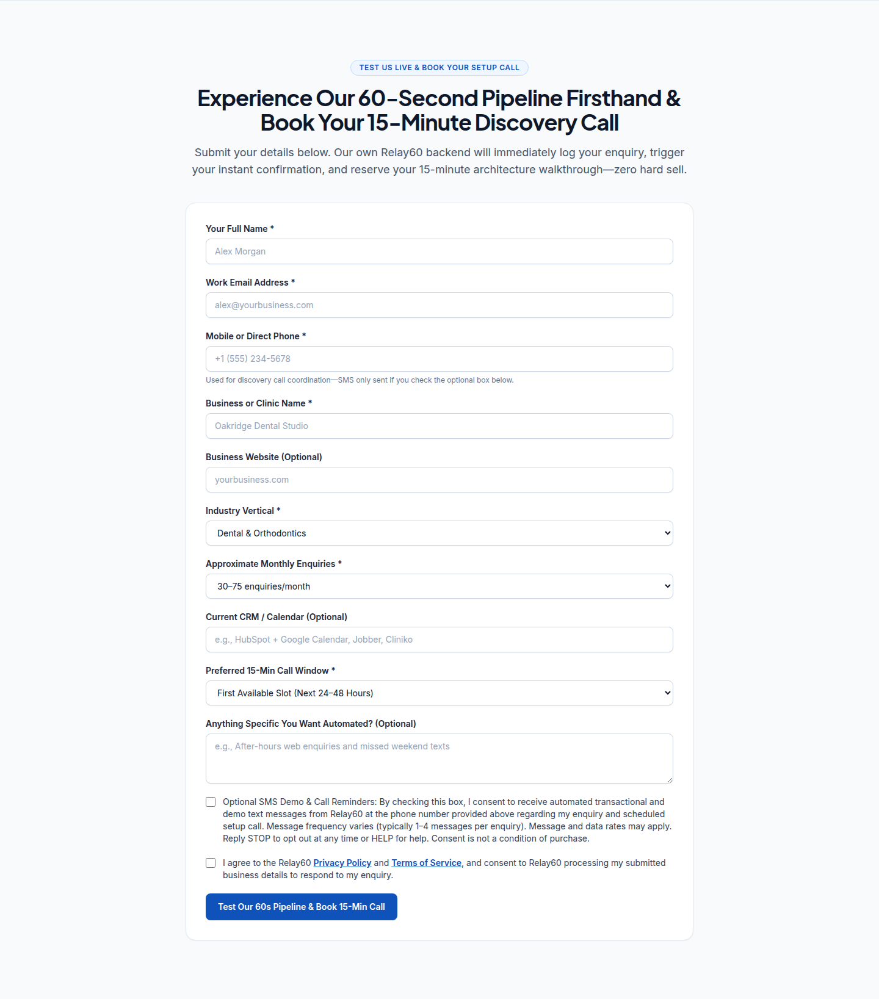

Validation after an empty submit on the UK region. The sticky header covers the top of this particular crop, including part of the name error. The visible errors are the blueprint strings for email, phone, business name, and privacy consent. SMS remains optional and has no error.

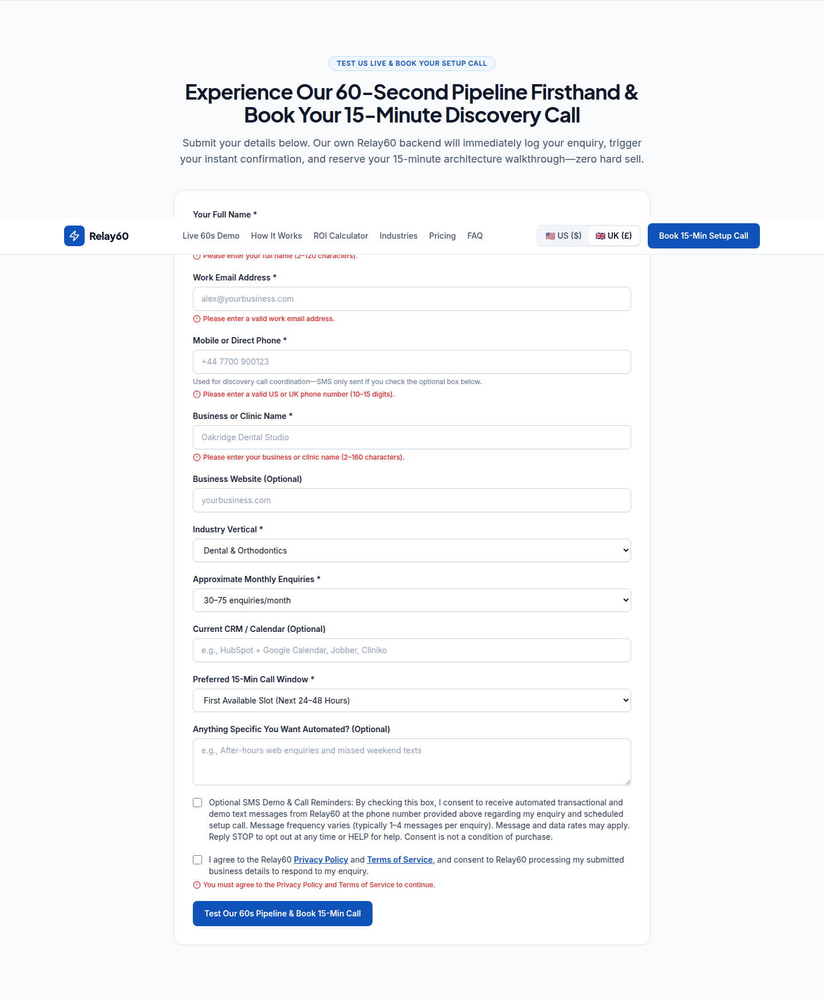

Successful UK submit with privacy checked and SMS left unchecked. The headline and message are the API strings. Email is queued. SMS says it was skipped because the checkbox was unchecked. The slot label is `First Available Slot (Next 24–48 Hours)`. No Cal.com or Calendly iframe is present because the embed URL is empty.

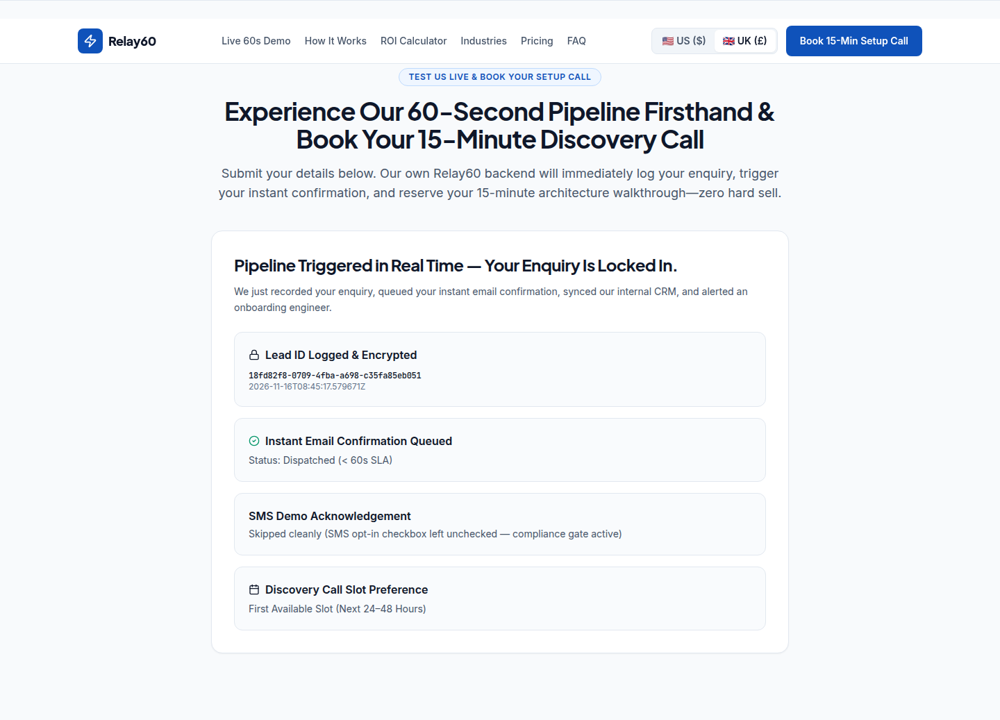

### Empty legal pages and the 404

`/privacy` has no policy heading and no clauses. Only the shared announcement bar, navigation, and footer remain.

`/terms` is the same kind of empty page. The tab title is still the terms title; the page body is empty.

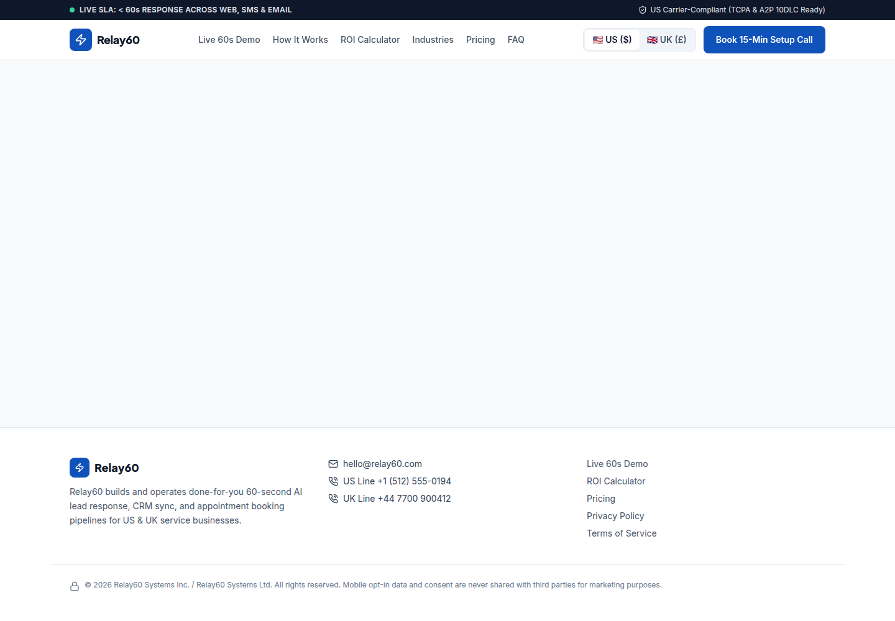

Unknown URL `/this-page-does-not-exist`. The 404 copy is the blueprint copy.

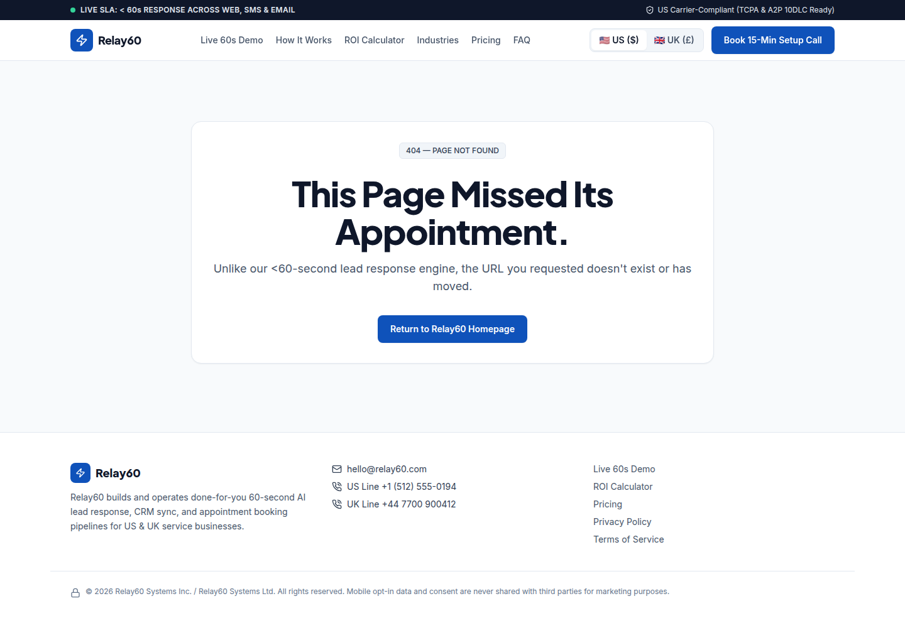

### Mobile

Full US home page at 390×844. It is a tall capture. The desktop navigation is replaced by the menu button. Sections stack. This image was not cropped per section, so a reviewer should open the file rather than rely on a tiny preview.

The full UK desktop page is also stored for side-by-side comparison with the US full page.

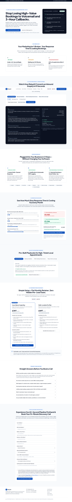

## 9. What a reviewer should decide

These are open judgments, not claims that the work is correct.

1. Is emptying `/privacy` and `/terms` the right final state, given that the user asked for it after the blueprint had required those pages to contain clauses the prompt never actually included?
2. Was writing those clauses in the first place an overstep, or the only way to satisfy a blueprint that cited missing text?
3. Are the implementer-written compliance footers and the custom-enquiry tag insertion acceptable interpretations, or should they be rejected because they are not verbatim blueprint sentences?
4. Is FastAPI's validate-then-rate-limit order a defect relative to the written algorithm?
5. Does the one-frame mismatch between a hydrated UK region and the still-US ROI ticket need a fix before this is considered finished?
6. Is the absence of a Docker image boot, a webhook integration test, an admin UI, and a captured mobile-menu-open screenshot a material verification gap?
7. Do the screenshots show any copy, price, or layout mismatch that the automated tests cannot see?

The source that should be read alongside this packet is `backend/app` and `frontend/src`. The test names in section 7 are the behavioral contract the implementer actually executed.
